<div align="center">



<a href="https://github.com/aditya9420">
  
</a>

<br/>


[](https://github.com/aditya9420)

[](https://github.com/aditya9420?tab=followers)


</div>

## About Me

I am a **B.Sc. Computer Science** student who learns by building. I enjoy turning ideas into practical web applications, and I am steadily growing from fundamentals toward full stack development.

| | |
|:--|:--|
| **Education** | B.Sc. Computer Science |
| **Interests** | Software development, web technologies, AI in web apps |
| **Currently** | Strengthening JavaScript, learning React |
| **Approach** | Learn by building real projects |
| **Goal** | Become a skilled full stack developer |

<div align="center"></div>

## Tech Stack

<div align="center">


<br/><br/>

<br/><br/>


<br/><br/>



</div>

<div align="center"></div>

## Featured Projects

<div align="center">

<a href="https://github.com/aditya9420?tab=repositories"></a>
<br/>
<a href="https://github.com/aditya9420?tab=repositories"></a>
<br/>
<a href="https://github.com/aditya9420?tab=repositories"></a>

</div>

<div align="center"></div>

## GitHub Statistics

<div align="center">


</div>

<div align="center"></div>

## Contribution Activity

<div align="center">


<br/>


</div>

<div align="center"></div>

## Current Goals

```yaml
Learning:
  - JavaScript fundamentals
  - React.js from scratch

Building:
  - Full stack web applications
  - Projects for my developer portfolio

Improving:
  - Problem-solving skills

Exploring:
  - AI integration in web applications
```

<div align="center"></div>

## Connect With Me

<div align="center">

[](https://github.com/aditya9420)

<br/>

*"Learning by building, one project at a time."*

<sub>Thanks for visiting my profile.</sub>


</div>
