# 👋 Hey, I'm Aditya Chavan

### 💻 Computer Science Student | Developer | Tech Enthusiast

  

  
  
  

---

## 🚀 About Me

- 🎓 Pursuing **B.Sc. Computer Science**
- 💻 Interested in software development and web technologies
- 🌱 Currently improving my JavaScript and learning React
- 🛠️ Enjoy building practical projects and exploring new technologies
- 🎯 Working towards becoming a skilled developer
- ⚡ I believe in learning by building.

---

## 🧰 Tech Stack

### Programming Languages

  

### Web Development

  

### Database & Tools

  

---

## 🏗️ Featured Projects

### 🔎 College Lost & Found Portal

A PHP and MySQL-based web application designed to help students and staff report, browse, and recover lost or found belongings.

**Technologies:** PHP · MySQL · HTML · CSS

### 🌱 AI Crop Disease Detection

A crop disease detection project exploring image-based disease identification with a PHP application and Python Flask backend.

**Technologies:** PHP · Python · Flask · MySQL

### 💻 Personal Portfolio

A personal portfolio website to showcase projects, technical skills, learning progress, and achievements.

**Technologies:** HTML · CSS · JavaScript

---

## 📊 GitHub Statistics

  

## 🔥 Contribution Activity

  

  

## 💻 Most Used Languages

  

## 📈 Development Activity

  

  

---

## 🎯 Current Goals

- [ ] Improve JavaScript fundamentals
- [ ] Learn React.js from scratch
- [ ] Build full-stack web applications
- [ ] Improve problem-solving skills
- [ ] Develop projects for my developer portfolio
- [ ] Explore AI integration in web applications

---

## 🤝 Connect With Me

  

---

  

  **✨ Thanks for visiting my profile!**
   
  Made with 💜 by Aditya Chavan

